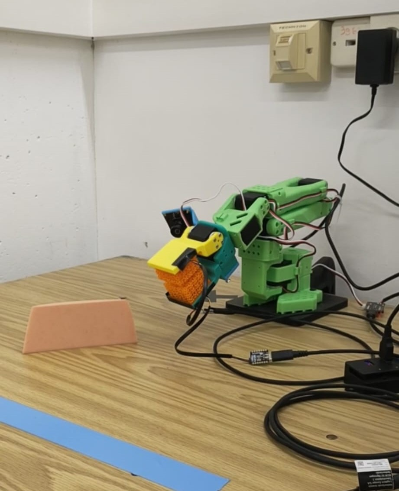
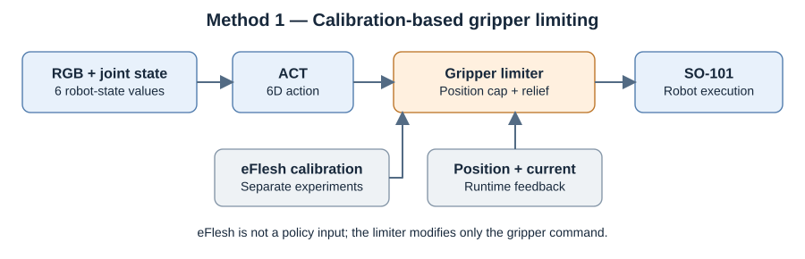
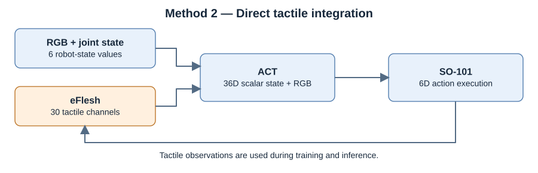
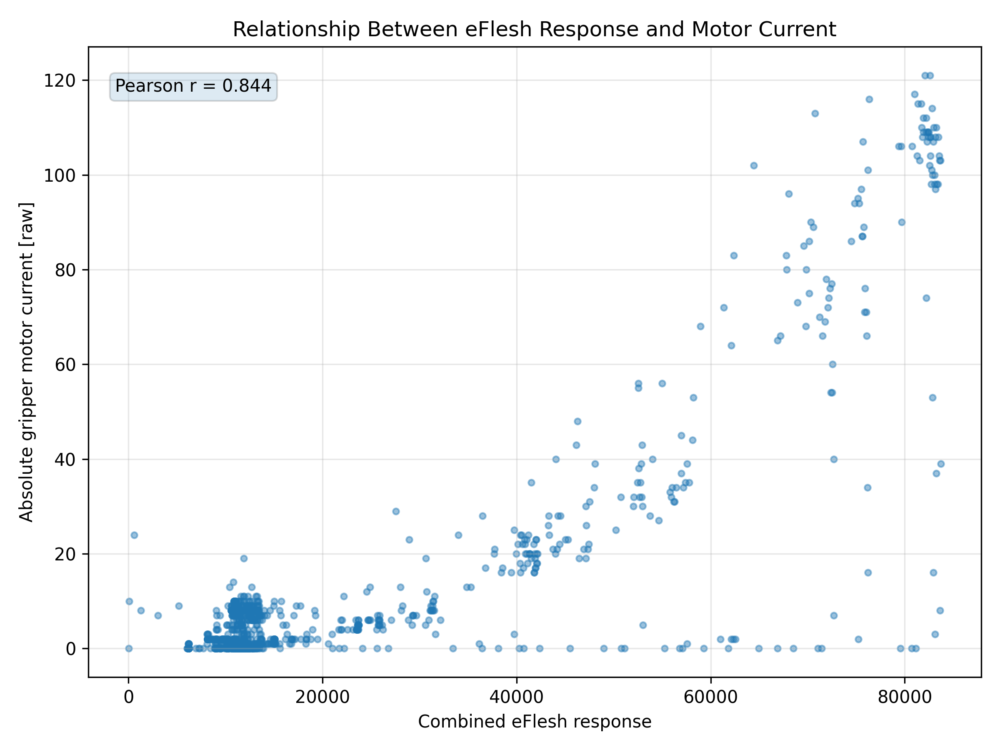
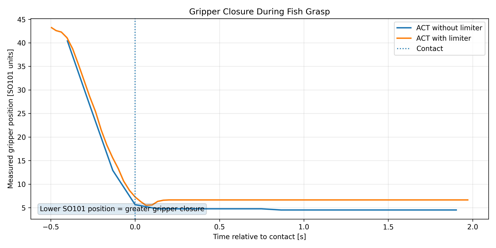
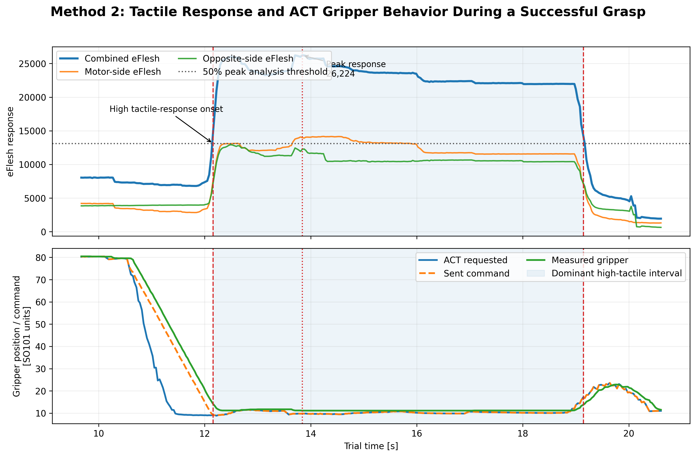
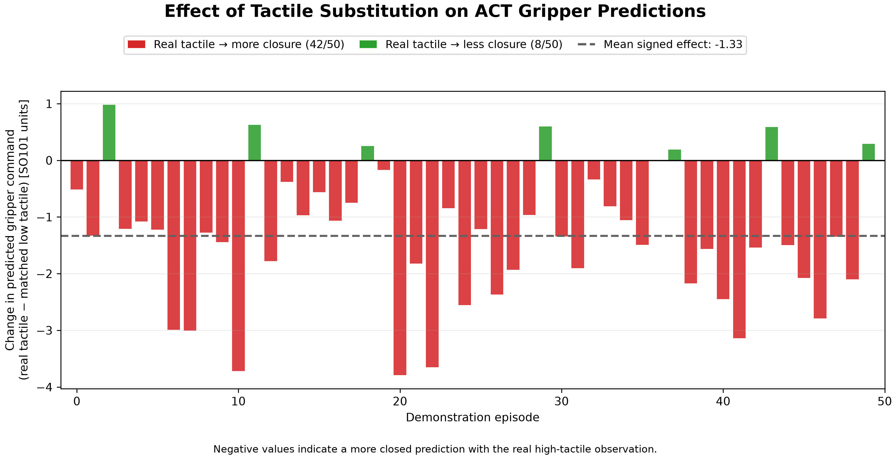
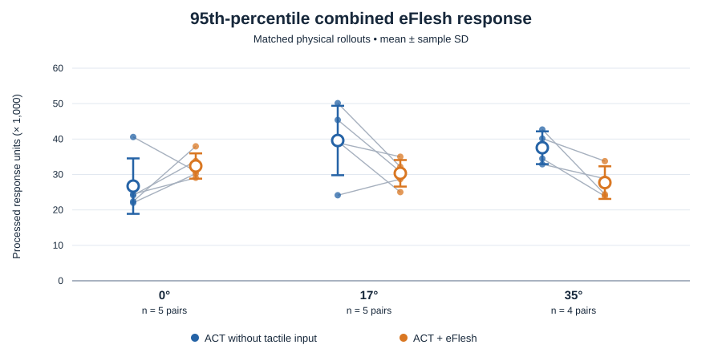

# Tactile-enhanced imitation learning for soft-object manipulation

**SO-101 · eFlesh magnetic tactile sensing · Action Chunking with Transformers (ACT)**

Engineering Project 2 (0340380), Technion – Israel Institute of Technology, 2026.  
Le Xuan Nhi and Dan Cukierman.

Can a robot learn to grasp a deformable object while using tactile information to manage the interaction? We implemented and evaluated two approaches on an SO-101 arm grasping a soft silicone fish.

<p align="center"></p>

## Robot demonstration

[](https://youtube.com/shorts/IOX4_Yiw77Q)

[Watch the demonstration (YouTube Shorts)](https://youtube.com/shorts/IOX4_Yiw77Q)

## Key results

| Experiment | Main finding |
| --- | --- |
| Tactile calibration | eFlesh response and absolute motor current were positively correlated (Pearson r = 0.844). |
| Method 1: external gripper limiter | Peak post-contact motor current decreased from 24 to 16 raw units (33.3%) in the evaluated comparison. |
| Method 2: direct tactile integration | ACT used 30 additional tactile channels during training and inference. |
| Offline input ablation | Replacing only tactile input changed the predicted gripper position by 1.475 SO-101 units on average (absolute difference, 50 observations). |
| Controlled physical policy ablation | Mean p95 tactile response changed by +21.3%, −23.4%, and −26.2% at 0°, 17°, and 35°, respectively. |

**Interpretation:** tactile integration influenced learned actions and reduced upper-range tactile response at the two perturbed orientations, but was not a universal safety mechanism. Neither force nor object deformation was independently calibrated.

## System and approaches

Two RGB cameras (640 × 480 at 30 fps), a leader–follower SO-101 setup, and two eFlesh sensing surfaces (five three-axis sensing locations per jaw). Each ACT action contains six target motor positions. The tactile input consists of 30 signed, baseline-relative magnetic components; the combined magnitude is used for analysis, not supplied as a single policy input.

| | Method 1: calibration-based limiting | Method 2: direct integration |
| --- | --- | --- |
| ACT input | 2 RGB views + 6 robot-state values | 2 RGB views + 6 robot-state values + 30 tactile channels |
| Tactile use | Separate calibration; not needed for final execution | During demonstration collection, training and inference |
| Runtime control | External gripper position cap and current-triggered relief | Learned policy, no Method 1-style tactile override |
| Training | 50 demonstrations, 50,000 steps | 50 demonstrations, 50,000 steps |





## Method 1 — Calibration-based gripper safety limiting

Five repeated squeezes characterized the combined tactile response after bilateral contact. The rigid reference and soft fish exhibited different response–closure relationships. The combined eFlesh/current correlation was r = 0.844.



The limiter uses a 12-unit contact-search window, a 6-raw-unit contact-current threshold, a 1-unit commanded post-contact closure cap, and current-relief/release thresholds of 9/6 raw units. The command cap is not a guaranteed physical displacement bound: the measured maximum post-contact closure was 1.76 units. Peak current decreased from 24 to 16 raw units. Mean/max ACT-command modification in the analyzed interval: 3.422/5.751 position units.



## Method 2 — Direct tactile integration

The scalar observation is 36-dimensional (6 robot + 30 tactile channels); the action remains 6-dimensional. The dataset comprises 50 episodes and 35,458 frames. ACT was trained for 50,000 steps with batch size 8 and a 100-step action horizon.

- [Public training dataset](https://huggingface.co/datasets/Cookieman12/grab_fish_eflesh_act_v1)
- [Public trained ACT checkpoint](https://huggingface.co/Cookieman12/grab_fish_eflesh_act_v1_50k)



In the representative successful rollout, the dominant high-tactile interval was 12.156–19.140 s. During its first two seconds, ACT-requested and transmitted gripper commands were identical; the generic LeRobot relative-target constraint remained enabled.

### Ablation A — Offline input sensitivity (no retraining)

For each demonstration, select its maximum-tactile frame and substitute a real low-tactile vector (lowest 30% of dataset responses), matched within two gripper-position units and by arm configuration. The original camera frames and six robot positions remain exactly fixed. Reset ACT before both predictions.

| Metric | Result |
| --- | ---: |
| Observations | 50 |
| Median tactile contrast | 3.31× |
| Mean / median absolute gripper change | 1.475 / 1.302 |
| 90th percentile / maximum absolute change | 2.993 / 3.793 |
| Mean signed change (real minus low) | −1.334 |
| Real input predicted more / less closure | 42 / 8 |
| Correlation of contrast with absolute change | 0.427 |

Gripper changes are in SO-101 position units; lower values mean greater closure.



This counterfactual experiment establishes sensitivity to tactile input, not physical force reduction.

### Ablation B — Controlled physical policy comparison (retraining)

Two ACT policies were trained from the same 50 demonstrations for 50,000 steps, with or without the 30 tactile inputs. Both were evaluated using the same eFlesh-equipped gripper, with sensors logged for both. At 35°, repeat 4 was excluded as a matched pair due to sensor corruption.



| Fish orientation | Valid pairs | ACT without tactile input | ACT + eFlesh | Mean change |
| --- | ---: | ---: | ---: | ---: |
| 0° | 5 | 26,714 | 32,391 | +21.3% |
| 17° | 5 | 39,592 | 30,334 | −23.4% |
| 35° | 4 | 37,550 | 27,706 | −26.2% |

Values are mean per-rollout 95th-percentile combined magnetic response (processed units), rounded to the nearest unit. All 28 retained rollouts completed the grasp. The tactile policy had lower p95 in 4/5 pairs at 17° and 4/4 at 35°. Integrated tactile exposure decreased at 17° but increased at 35°; motor current did not consistently follow tactile response.

See [physical-ablation methods, data and quality notes](docs/physical-ablation.md) and [trial-level metrics](results/physical_tactile_ablation/clean_trial_metrics.csv).

## Reproduce the analysis

See [reproduction guide](docs/reproduction.md) for installation, commands, dataset/model links, hardware caveats and the original offline-ablation checksum.

```bash
pip install -r requirements.txt
python scripts/method1/generate_method1_figures.py
python scripts/common/generate_expanded_results_figures.py
python scripts/method2/generate_ablation_figures.py
python scripts/method2/summarize_physical_ablation.py
```

The plotting and summary scripts use the committed analysis data. Full offline inference requires the separate LeRobot/PyTorch environment. Physical execution requires calibrated hardware and the original tactile-enabled LeRobot integration; see the guide.

## Repository map

| Path | Contents |
| --- | --- |
| [hardware/](hardware/) | Custom eFlesh gripper holders and CAD documentation |
| [data/](data/) | Calibration, rollouts and offline-ablation observations |
| [figures/](figures/) | Experimental plots and hardware photograph |
| [results/](results/) | Summary tables and trial-level metrics |
| [scripts/method1/](scripts/method1/) | Limiter and calibration plots |
| [scripts/method2/](scripts/method2/) | Tactile rollout, ablation and analysis |
| [docs/](docs/) | Reproduction instructions and experiment details |

## Limitations

- eFlesh measures magnetic response associated with tactile-surface deformation, not calibrated force; current is in raw telemetry units.
- Method 1 and Method 2 used different demonstration sets and gripper configurations and are not a controlled head-to-head comparison.
- The physical policy ablation had only 5, 5 and 4 matched pairs and one trained policy per condition. The observed effects are descriptive, not statistically established generalization.
- Lower tactile response does not necessarily imply lower force, reduced fish deformation or lower motor loading.
- Generalization to unseen objects was not evaluated.

## References

- [ACT — Zhao et al. (2023)](https://arxiv.org/abs/2304.13705)
- [eFlesh — Pattabiraman et al. (2025)](https://arxiv.org/abs/2506.09994)
- [Diffusion Policy — Chi et al. (2023)](https://arxiv.org/abs/2303.04137) (evaluated preliminarily; the available implementation ran at approximately 0.6 Hz).
- [LeRobot](https://github.com/huggingface/lerobot)

