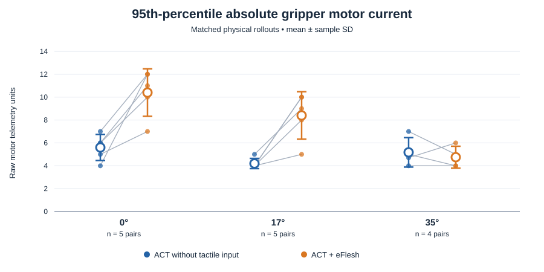

# Controlled physical tactile-input ablation

## Experimental design

Compare ACT trained with RGB and six joint values against ACT trained on the same 50 demonstrations with 30 additional signed magnetic channels. Both were trained for 50,000 steps and used the same evaluation hardware and generic relative-target constraint. Tactile signals were logged in both conditions, but only supplied to the tactile policy. The soft fish was placed at 0°, 17° and 35° clockwise; five matched repetitions per angle were planned and policy order was alternated.

## Data and exclusions

The [clean trial metrics](../results/physical_tactile_ablation/clean_trial_metrics.csv) contain 28 retained rollouts in original run order, with four metrics recomputed from the archived per-frame CSVs (rounded to six decimal places). All four metrics were checked against the corresponding clean entries in the original trial-metrics table. The complete frame-level archive is not included in this revision.

- R17 repeat 5, tactile policy: the original run contained a corrupted tactile frame and was re-recorded. The replacement SUCCESS recording is used.
- R35 repeat 4: original no-tactile run had no normal grasp; subsequent recordings contained severe tactile corruption. Exclude the entire matched pair from every principal comparison, including current. The clean sample is repeats 1, 2, 3 and 5.
- Retained pair counts: 5, 5, 4. All retained runs were labeled successful. These are not estimates of general task-success probability; excluded and superseded runs are not counted as successful trials.

Raw files should be preserved unchanged when released; never silently remove sensor frames.

## Metrics

- p95_tactile: 95th percentile of the combined eFlesh response over a rollout.
- peak_tactile: maximum of that response.
- tactile_auc: time integral of the response (trapezoidal rule, response units × s).
- p95_current: 95th percentile of absolute measured current (raw motor-telemetry units).

The combined tactile magnitude is the sum of the ten baseline-relative three-axis Euclidean norms. It is not force in newtons. Each trial is the analysis unit; frame samples are not independent trials. Change is 100 × (mean with tactile / mean without tactile − 1). Dispersion uses sample standard deviation. The script validates matched pairs and reproduces the [summary](../results/physical_tactile_ablation/summary.csv).



At 17°, peak tactile response decreased by about 23.1% and integrated response by 14.7%. At 35°, the upper-range response decreased, while integrated response increased by 8.8%. Motor current increased at 0° and 17° and decreased at 35°. These mixed metrics do not establish reduced contact force or object deformation.

The tactile policy exhibited smaller between-rollout p95 tactile dispersion at 0° and 17°, with similar absolute spreads at 35°. The small sample and lack of repeated policy training prevent stronger claims.

## Regenerate summaries

From the repository root:

```bash
python scripts/method2/summarize_physical_ablation.py
```

The generated plot files in the repository are paired plots from the clean metrics, with individual pairs connected and outlined markers showing mean ± sample standard deviation. They are new visualizations of the original data, not the original Overleaf images.
