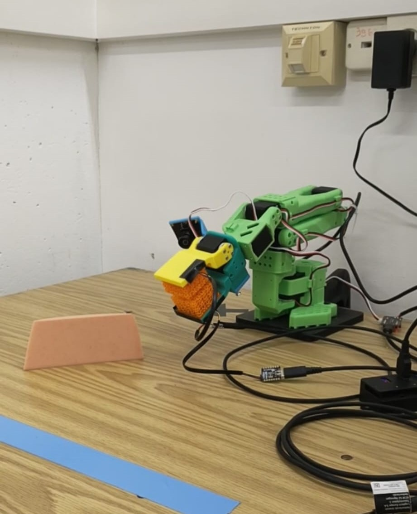

# Custom eFlesh gripper holders

The SO-101 gripper was adapted to mount an eFlesh tactile sensing surface on each opposing finger.

## 3D-printable files

Both modified gripper parts are provided in STL format for 3D printing.

| STL file | Description |
| --- | --- |
| [moving_jaw_eflesh_holder.STL](moving_jaw_eflesh_holder.STL) | Moving jaw with an eFlesh mounting slot |
| [wrist_roll_follower_eflesh_holder.STL](wrist_roll_follower_eflesh_holder.STL) | Wrist roll follower with an eFlesh mounting slot |

Click either file to preview its geometry directly on GitHub or download it for slicing.

## Printing and assembly

The STL files represent the modified gripper components, not the compliant eFlesh sensing lattices. See the [eFlesh paper](https://arxiv.org/abs/2506.09994) for the sensing principle and original lattice design.

